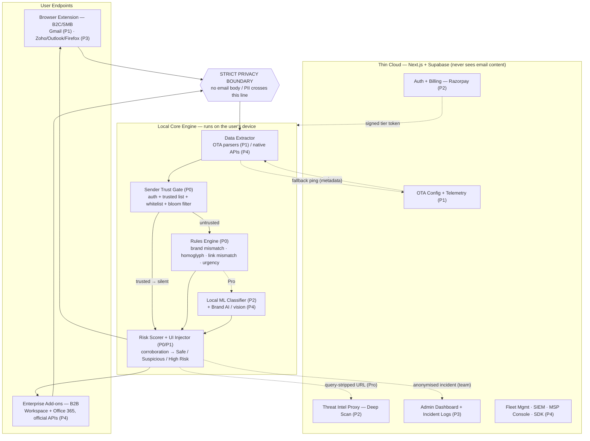

# Architecture

## Pattern: Core + Adapters (Hexagonal)

The detection logic (the "brain") is fully separated from how email is read (the "eyes").
This single decision lets the same engine power the browser extension today and native
API add-ons later without rewriting the logic.

- **`core/`** — pure TypeScript. Takes a structured `EmailData`, returns a `Verdict`.
  **Zero** DOM, **zero** `chrome.*`, no network. Unit-testable in Node. *(Built P0.)*
- **`adapters/`** — provider-specific "eyes": read the page/API, produce `EmailData`,
  render the verdict. Gmail (P1); Zoho/Outlook/Firefox (P3); native Workspace/Office
  add-ons (P4).
- **`cloud/`** — thin Next.js + Supabase backend: OTA config, telemetry, report intake
  (P1); auth/billing + Deep Scan proxy (P2); dashboard + synced rules (P3); fleet/SIEM/
  SDK (P4). **Never sees email content.**

## The full architecture (broad, not scoped down)

This is the canonical diagram. Boxes are tagged with the phase they are built in. The
**privacy boundary** (dashed) is absolute: email body, subject, sender name, and PII
never cross it.

## Layer summary

1. **User Endpoints (the eyes' housing).** Browser extension for B2C/SMB (DOM-based);
   native add-ons for B2B (API-based, immune to UI change, covers mobile).
2. **Privacy boundary.** Extracted email data flows *down* into the local engine and is
   physically prevented from flowing *out* to the network.
3. **Core Engine (the brain).** Runs 100% locally. Extract → Trust Gate → (Rules → ML) →
   Scorer → UI. See `detection.md`.
4. **Thin Cloud (the nervous system).** Keeps the engine alive and improving; handles
   licensing, optional Deep Scan, and B2B visibility — without email content.

## Data flow — life of one email

1. **Open.** Adapter observer fires (SPA navigation / mutation), debounced, de-duped by
   message id.
2. **Extract.** OTA selectors → on failure, confidence-checked heuristic fallback →
   `EmailData`. **Last point email content exists; it never leaves the device.**
3. **Gate.** Trust Gate: authenticated + trusted (or whitelisted) → `Safe`, no banner, done.
4. **Analyse.** Otherwise run rules (and, for Pro, the ML classifier) → weighted signals.
5. **Score.** Corroboration → Safe / Suspicious / High Risk.
6. **Inject.** Only Suspicious/High Risk produces a banner + inbox pill.
7. **Callbacks (metadata/URL only).** Fallback ping; optional Deep Scan (query-stripped
   URL); team incident log. Nothing else is ever sent.

## Why the cloud exists

To keep the local engine alive and improving — OTA self-healing, telemetry, licensing,
optional Deep Scan, and (later) B2B visibility — never to read email.
